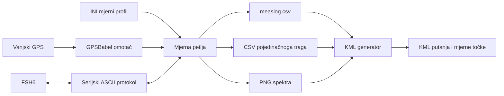

# RoadScan: arhitektura i poznata problematična mjesta

Ovaj dokument opisuje zatečeno stanje projekta RoadScan prije eventualne
modernizacije. Nastao je statičkom analizom revizije `a8ad75b`; komunikacija sa
stvarnim analizatorom Rohde & Schwarz FSH6 i GPS prijamnikom nije ponovno
provjerena u sadašnjem okruženju.

Prema potvrdi autora, cjelokupan je sustav u različitim vremenskim razdobljima
uspješno odradio više stvarnih mjernih vožnji, uključujući sesije koje su
trajale po nekoliko sati. Dokumentirana problematična mjesta stoga nisu tvrdnja
da sustav nije radio. Ona opisuju tehnički dug, rizike ponovnoga pokretanja i
točke na kojima bi modernizacija mogla nenamjerno ukloniti rješenje uvedeno
zbog konkretnoga hardvera, firmwarea, Linuxa ili tada dostupnih Python paketa.

Zbog terenske povijesti projekta dokument razlikuje:

- potvrđene programske nedostatke, vidljive iz samoga koda;
- potvrđene protokolarne zahtjeve i zaobilaznice uvedene zbog ponašanja
  konkretnoga FSH6;
- ostale pretpostavke i zaobilaznice koje su možda namjerno uvedene zbog
  ponašanja hardvera ili tadašnjih Python paketa;
- dijelove koje prije izmjene treba potvrditi snimkom stvarne komunikacije ili
  poznatim dobrim mjernim izlazom.

## 1. Namjena sustava

RoadScan je alat za mobilno mjerenje radiofrekvencijskoga spektra. Tijekom
vožnje periodički:

1. dohvaća zemljopisni položaj vanjskoga GPS prijamnika;
2. konfigurira i očitava trag spektra s analizatora FSH6;
3. povezuje trag, položaj i vrijeme;
4. sprema detaljne rezultate i sliku spektra;
5. nakon mjerenja pretvara sažeti zapis vožnje u KML.

Temeljna podatkovna jedinica zamišljena je kao:

```text
jedno vrijeme + jedan GPS položaj + jedan trag spektra + izvedeni maksimum
```

## 2. Pregled arhitekture



Softver GPS i FSH6 podatke dohvaća sekvencijski i ne jamči njihovu istodobnost
ni zajedničku vremensku sinkronizaciju. Novija grana prvo dohvaća GPS položaj,
a zatim traži trag spektra; izvorna grana radi obrnutim redoslijedom. FSH6
pritom može raditi u kontinuiranom sweepu, pa se bez hardverske provjere ne
može tvrditi u kojoj se mjeri fizička mjerenja vremenski preklapaju. Zapisano
vrijeme jest UTC vrijeme sustavskoga računala, a ne vrijeme dobiveno iz GPS-a.
Zato izraz „položaj mjerenja” u postojećem formatu znači približno pridruženi
položaj unutar jednoga programskog ciklusa.

## 3. Razvojne grane

U repozitoriju su ostale tri generacije aplikacije.

| Generacija | Ulazna točka | Upravljački moduli | Izlaz |
| --- | --- | --- | --- |
| Izvorni CLI | `gpspectrum.py` | `devices/FSH6mgr.py`, `devices/Gpsmgr.py` | `csv/`, `image/`, `measlog.csv`, `total.csv` |
| Noviji CLI | `roadscan-cli.py` | `devices/FSH6.py`, `devices/Garmin.py` | `csv/`, `png/`, `measlog.csv` |
| Tkinter GUI | `roadscan-gui.py` | `measurements/mobile.py`, `devices/FSH6.py`, `devices/Garmin.py` | isti format kao noviji CLI |

Zasebno postoje dvije inačice KML generatora:

- `maplayer.py`, CLI prilagođen starijem direktoriju `image/`;
- `maplayer-gui.py`, PySide/Qt4 GUI koji pretpostavlja direktorije `csv/` i
  `png/`.

Datoteke `maplayer-gui.ui` i `kml_generator.ui` međusobno su jednake. Izvršni
kod ih ne učitava izravno, nego uvozi generirani `maplayerDesign.py`, čije
zaglavlje navodi da je nastao iz `kml_generator.ui`. Tkinterovo mjerno sučelje
u `roadscan-gui.py` nije povezano s tim Qt `.ui` datotekama.

Aktivna datoteka `gpspectrum.py` povijesno je najstarija grana i ne treba je
smatrati kanonskim prikazom posljednje implementacije. Funkcionalni razvoj u
Git povijesti uglavnom je koncentriran u 2016. i početak 2017., dok zaglavlje
`gpspectrum.py` početak koda datira u 2010.

## 4. Glavne komponente

| Putanja | Odgovornost |
| --- | --- |
| `gpspectrum.py` | Izvorna monolitna mjerna petlja, crtanje i zapisivanje |
| `roadscan-cli.py` | Novija mjerna aplikacija za naredbeni redak |
| `roadscan-gui.py` | Tkinter upravljanje, radna dretva i prikaz posljednjega mjerenja |
| `devices/FSH6.py` | Noviji niskorazinski serijski upravljač analizatora |
| `devices/FSH6mgr.py` | Starija inačica istoga upravljača koja sama čita INI |
| `devices/Garmin.py` | GPSBabel omotač koji se koristi u novijoj grani |
| `devices/Gpsmgr.py` | Oštećena starija inačica GPS omotača |
| `measurements/mobile.py` | Pokušaj objedinjavanja jednoga mjernog koraka |
| `conf/*.ini` | Profili frekvencijskoga područja i postavki instrumenta |
| `maplayer.py` | Stariji izvoz `measlog.csv` u KML iz naredbenoga retka |
| `maplayer-gui.py` | PySide/Qt4 sučelje za KML izvoz |
| `templates/*.xml` | Predlošci KML zaglavlja, putanje, točke i podnožja |
| `scripts/` | Terenske skripte za pokretanje unaprijed odabranih profila |
| `tests/` | Ručni pokusi i prototipovi; nije automatizirani testni paket |

Pokretačke skripte `roadscan.sh` i `maplayer.sh` samo pozivaju odgovarajuće
Python datoteke u pozadini. Ne postavljaju radni direktorij, interpreter,
virtualno okruženje ni ovisnosti.

## 5. Tijek jednoga mjernog ciklusa

### 5.1. Noviji CLI

Glavna petlja nalazi se u `roadscan-cli.py:244–359`:

1. učitava puni put do odabranoga INI profila;
2. računa frekvencijsku os i prag;
3. stvara direktorije sesije;
4. dohvaća GPS položaj;
5. otvara FSH6 i ponovno mu šalje mjernu konfiguraciju;
6. poziva `GET TRACE` i čita jedan redak odgovora;
7. prihvaća samo odgovor čija je sirova duljina 301;
8. odbacuje prvi ciklus radi zaostaloga međuspremnika;
9. izračunava minimum, maksimum i prekoračenje praga;
10. zapisuje CSV traga, PNG i redak u `measlog.csv`;
11. čeka zadani broj sekundi i ponavlja ciklus.

GPS položaj uzima se prije očitanja spektra, dok se vremenska oznaka za log
uzima nakon očitanja.

### 5.2. Tkinter GUI

GUI dijeli istu domensku logiku, ali je rad razdvojen između glavne Tkinter
dretve i radne dretve `AppThread.measLoop()`:

- glavna dretva upravlja widgetima i crta Matplotlibov graf;
- radna dretva čita GPS i FSH6, računa rezultate i sprema datoteke;
- tekstualna poruka oblika
  `GPS;maksimum;vrijeme;jedinica;putanja_png` prenosi se kroz `Queue`;
- sami nizovi frekvencija i razina ostaju u zajedničkim globalnim varijablama.

Radna dretva pokreće se već pri stvaranju aplikacije, prije korisnikova pritiska
na Start. Posljedice su opisane u odjeljku o poznatim problemima.

### 5.3. Izvorni `gpspectrum.py`

Funkcija `onestep()` u `gpspectrum.py:196–293`:

1. konfigurira i čita FSH6;
2. zatvara analizator;
3. tek zatim dohvaća GPS položaj;
4. zapisuje detaljni CSV, zajednički `total.csv`, `measlog.csv` i PNG.

Ta grana posebno pokušava isprazniti prethodni međuspremnik te različito čeka
u načinima Max Hold i Min Hold. To ponašanje može biti hardverska zaobilaznica
i ne treba ga uklanjati bez provjere na instrumentu. Za razliku od novije
grane, redak u `measlog.csv` zapisuje samo kada maksimum prelazi prag.

## 6. Komunikacija s FSH6

### 6.1. Serijski parametri

`devices/FSH6.py` i `devices/FSH6mgr.py` postavljaju:

| Parametar | Vrijednost |
| --- | --- |
| Brzina | 19200 baud |
| Podatkovni bitovi | 8 |
| Paritet | bez pariteta |
| Stop bitovi | 1 |
| Timeout | 1 s |
| XON/XOFF | isključeno |
| RTS/CTS | isključeno |

### 6.2. Naredbe

Implementacija rabi dvorazinski tekstualni protokol završen znakom CR:

```text
CMD\r
REMOTE\r | PRESET\r | LOCAL\r

SET\r
FREQ,<središnja frekvencija>\r
SPAN,<raspon>\r
SWPTIME,<vrijeme>\r
SWPCONT,<0 ili 1>\r
UNIT,<kôd>\r
TRACEMODE,<kôd>\r
TRACEAVG,<broj>\r
TRACEDET,<kôd>\r
RBW,<kôd>\r
VBW,<kôd>\r

GET\r
TRACE\r
```

Poziv `cmd('PRESET\r')` namjerno prolazi kroz metodu `cmd()`, koja dodaje još
jedan CR. Na serijski se port zato šalje `PRESET\r\r`. Autor potvrđuje da je
dvostruki CR bio nužan kako bi uporabljeni FSH6 vratio ispravan izlaz; nije
riječ o slučajnom dvostrukom terminatoru. Taj detalj treba tretirati kao dio
protokolarnoga ugovora s provjerenim primjerkom instrumenta i njegovim tadašnjim
firmwareom.

Središnja frekvencija i span računaju se iz `frequency.start` i
`frequency.stop`. Odgovori ili potvrde konfiguracijskih naredbi ne čitaju se.
Naredbe `INIT` i `WAIT` postoje samo kao zakomentirane zamisli.

### 6.3. Obrada traga

`getresults()` poziva jedan `serial.readline()`, dijeli odgovor zarezima i
zatim svako polje dijeli znakom CR. Viši sloj očekuje sirovu duljinu 301, ali
zatim uklanja prazna polja i radi s frekvencijskim nizom od 300 elemenata.

Autor potvrđuje da je asimetrija 301 ulazni uzorak prema 300 izlaznih vrijednosti
bila nužna za dobivanje ispravnoga izlaza s uporabljena FSH6. Točan razlog na
razini firmwarea i formata odgovora nije sačuvan u kodu, ali ponašanje nije
slučajna pogreška brojenja i ne smije se mehanički „ispraviti” na 300→300 ili
301→301.

Pri modernizaciji taj se odnos najprije mora zapisati kao regresijski test nad
poznatim dobrim sirovim odgovorom. Tek zatim ima smisla provjeriti ponaša li se
jednako konkretna inačica firmwarea koja je danas dostupna za FSH6.

## 7. GPS sloj

Novija grana koristi `devices/Garmin.py`. Pri svakom očitanju:

1. stvara novi `gpsbabel.GPSBabel()` objekt;
2. poziva `getCurrentGpsLocation(port, gps_type)`;
3. očekuje tekstualni/XML-sličan prikaz s elementom koji počinje s `<None`;
4. ručno izdvaja `lat` i `lon` pomoću `split()` i `strip()`;
5. vraća string `"latitude,longitude"`.

Zadani su GPS model `garmin` i port `usb:`. Glavni tok ne koristi postojeću
metodu `getgpstime()`.

Ako je GPS isključen ili očitanje ne uspije, novija grana vraća
`0.000000,0.000000`. U izlaznom formatu nema zasebnoga statusa valjanosti, pa
se ne mogu razlikovati:

- namjerno isključen GPS;
- uređaj bez fixa;
- komunikacijska ili programska pogreška;
- stvarni položaj 0°, 0°.

Ne spremaju se broj satelita, HDOP, visina, brzina, smjer, starost fixa ni
izvor GPS vremena.

## 8. Mjerni profili

Većina datoteka u `conf/` ima ove sekcije:

| Sekcija | Polja | Namjena |
| --- | --- | --- |
| `frequency` | `start`, `stop` | rubovi mjerenoga raspona u Hz |
| `bandwidth` | `resolution`, `video` | kodovi RBW i VBW postavki |
| `sweep` | `time`, `continous` | trajanje i način sweepa |
| `unit` | `unit` | kôd mjerne jedinice |
| `trace` | `mode`, `average`, `detector` | način traga, prosjek i detektor |
| `repetition` | `reset`, `cycle` | reset instrumenta i dodatno čekanje |
| `level` | `threshold`, `noise` | prag i deklarirana razina šuma |

Profili pokrivaju BC/FM, avio VHF, TV UHF, GSM 900/1800, UMTS 2100, DECT,
RFID, 802.11 i multipleks 36.

Mjerni CSV ne pohranjuje kopiju uporabljenoga profila. Za kasniju reprodukciju
potrebno je odvojeno sačuvati INI koji je bio aktivan u trenutku mjerenja.

## 9. Izlazni formati

### 9.1. Struktura sesije

Novija grana stvara:

```text
<izlaz>/<UTC-vrijeme-sesije>/
├── csv/
│   ├── measlog.csv
│   ├── <lat-lon_UTC-vrijeme>.csv
│   └── ...
└── png/
    ├── <UTC-vrijeme>.png
    └── ...
```

Izvorna grana rabi `image/` umjesto `png/` te dodaje `total.csv` i privremeni
`biggles.tmp`.

### 9.2. CSV pojedinačnoga traga

Novija grana piše:

```csv
i, frequency, magnitude
0,<frekvencija_0>,<magnituda_0>
1,<frekvencija_1>,<magnituda_1>
```

Položaj, vrijeme i putanje nisu ponovljeni u toj datoteci. Veza se čuva u
nazivu datoteke i `measlog.csv`.

### 9.3. `measlog.csv`

```csv
datetime,latitude,longitude,abovethreshold,csvfile,pngfile
```

`abovethreshold` se računa kao:

```text
max(0, najveća izmjerena razina - konfigurirani prag)
```

U logu nema inačice formata, identiteta analizatora, GPS statusa, aktivnoga
profila, mjerne jedinice, RBW/VBW postavki ni podataka o kalibraciji.

### 9.4. `total.csv` iz izvorne grane

`gpspectrum.py` dodatno pokušava zapisati svaku spektralnu točku svakoga traga
u zajednički `total.csv` sa stupcima:

```csv
datetime,latitude,longitude,frequency,magnitude,csvfile,pngfile
```

Novija CLI i GUI grana više ne stvaraju tu datoteku.

SQLite izlaz bio je razmatran u `gpspectrum.py`, ali pripadajuće opcije i
brisanje stare baze ostali su potpuno zakomentirani.

## 10. Grafički prikaz i KML

Matplotlib crta crvenu krivulju magnitude prema frekvenciji, s mrežom i UTC
vremenom u naslovu. Novija GUI grana graf ne ugrađuje u Tkinter widget, nego
u glavnoj dretvi upravlja zasebnom Matplotlib figurom i sprema PNG.

KML generator svaki redak `measlog.csv` pretvara u:

- jednu točku `Placemark` s poveznicom na CSV i PNG;
- jedan zajednički `LineString` putanje.

Koordinate putanje imaju oblik:

```text
longitude,latitude,abovethreshold
```

Treća KML koordinata formalno je visina, a ovdje se namjerno koristi za
vizualizaciju prekoračenja praga. Uz `extrude=1` i `relativeToGround` dobiva se
izdignuta 3D putanja. Vrijednost u dB tako je semantički prikazana kao visina
u metrima; to je vizualna metafora, ne geodetska visina.

KML ne ugrađuje CSV i PNG te ne izrađuje KMZ. Poveznice rade samo ako su
odgovarajući direktoriji premješteni zajedno s KML-om u očekivanoj strukturi.

## 11. Upravljanje stanjem i paralelnost

Klasa `AsyncWrite` otvara datoteku u zasebnoj Python dretvi. U mjernoj petlji
za svaku spektralnu točku nastaje nova dretva koja istu CSV datoteku otvara u načinu `a`,
dok druga dretva istu datoteku otvara u načinu `w` radi zaglavlja.

Ne postoje:

- zaključavanje po datoteci;
- jedan red čekanja za serijsko zapisivanje;
- `join()` prije crtanja ili završetka sesije;
- atomska zamjena gotove datoteke;
- potvrda da su svi zapisi završeni prije izlaska iz procesa.

To može promijeniti redoslijed redaka, pregaziti već zapisane podatke ili
ostaviti nepotpun zapis pri gašenju. Na malom računalu stvara približno 300
dretvi po prihvaćenom tragu.

GUI dodatno rabi globalne liste `frequencies` i `levels`. Red poruka prenosi
samo metapodatke, pa grafička dretva ne prima nepromjenjivu kopiju konkretnoga
traga.

## 12. Poznata problematična mjesta

### 12.1. Potvrđeni programski i podatkovni problemi

| ID | Utjecaj | Problem | Referenca |
| --- | --- | --- | --- |
| SW-01 | visok | Projekt ovisi o Pythonu 2 (`ConfigParser`, `Tkinter`, `Queue`, stari `print`), dok Python 3 zahtijeva i `bytes` prilagodbu serijskoga sloja. | `devices/FSH6.py`, `roadscan-gui.py`, `maplayer.py:88` |
| SW-02 | visok | `requirements.txt` nema inačice, a PySide i Matplotlib su komentirani; NumPy nije naveden iako ga `gpspectrum.py` uvozi. | `requirements.txt` |
| LEG-01 | visok | U `devices/Gpsmgr.py` deklaracija `getpos()` je zakomentirana. Njezino tijelo ostaje dio `__init__`, konstruktor pokušava vratiti string, a objekt nema uporabljiv `getpos()`. | `devices/Gpsmgr.py:11–38` |
| IO-01 | visok | Stotine konkurentnih `AsyncWrite` dretvi zapisuju istu datoteku bez sinkronizacije i bez čekanja završetka. | `gpspectrum.py:36–46,250–288`; `roadscan-cli.py:219–229,319–345`; `roadscan-gui.py:45–55,454–487` |
| GPS-01 | visok | Sve GPS pogreške pretvaraju se u valjano izgledajuću točku `0.000000,0.000000`. | `roadscan-cli.py:207–216`; `measurements/mobile.py:75–84` |
| GPS-02 | srednji | Parser rabi `str.strip()` kao da uklanja prefiks te može ostaviti `lat` i `long` nedodijeljenima. | `devices/Garmin.py:22–38` |
| GUI-01 | visok | Radna dretva odmah učita `default.ini`; poslije odabrani profil može konfigurirati instrument, dok os, jedinica i prag ostanu iz defaulta. | `roadscan-gui.py:370–417` |
| GUI-02 | visok | Stop prekida spremanje, ali GPS i FSH6 očitanje nastavljaju se jer se `wt1_running` provjerava tek nakon mjerenja. | `roadscan-gui.py:418–489` |
| GUI-03 | srednji | Dok `measEq` još ne postoji, radna dretva radi u petlji sa `sleep=0`, što može nepotrebno opteretiti CPU. | `roadscan-gui.py:39,378–418,488` |
| GUI-04 | srednji | Provjera `Unknown` uspoređuje Tkinter widget sa stringom umjesto vrijednosti `self.fsh6port.get()`. | `roadscan-gui.py:267–270` |
| GUI-05 | srednji | Provjera praznoga rezultata `pyudev.list_devices()` uspoređuje rezultat sa stringom `''`, pa ne otkriva praznu listu kako je zamišljeno. | `roadscan-gui.py:224–250` |
| FSH-01 | srednji | `trace_mode` dolazi kao string, ali uspoređuje se s cijelim brojem `1`, pa se `TRACEAVG` grana ne izvršava. | `devices/FSH6.py:77–81`; `devices/FSH6mgr.py:77–81` |
| FSH-02 | visok | Noviji CLI/GUI ne primjenjuje `repetition.cycle` za Max Hold ili Min Hold. Stariji `gpspectrum.py` jedini čeka to razdoblje. | `measurements/mobile.py:49–62`; `roadscan-cli.py:138–151`; `gpspectrum.py:218–233` |
| CFG-01 | visok | `conf/80211.ini` nema `[level] threshold`, koji CLI bezuvjetno čita. | `conf/80211.ini`; `roadscan-cli.py:257–265` |
| CFG-02 | visok | `conf/gsm900ul.ini` dvaput definira `[level]`; strogi parser prijavljuje `DuplicateSectionError`. | `conf/gsm900ul.ini:63–91` |
| CFG-03 | srednji | Zadana vrijednost novijega CLI-ja jest `bcfm`, iako taj tok očekuje put do datoteke. Bez `-c` ne otvara `conf/bcfm.ini`. | `roadscan-cli.py:47–48,88–92,252–265` |
| CFG-04 | nizak | Vrijednost `level.noise` postoji u profilima, ali je produkcijski mjerni tok ne čita. | `conf/*.ini`; mjerne ulazne točke |
| KML-01 | srednji | CSV se raščlanjuje ručnim `split(',')`, bez CSV pravila, provjere stupaca i XML escapinga. | `maplayer.py:51–73`; `maplayer-gui.py:150–186` |
| KML-02 | srednji | Provjera praznoga retka pristupa prvomu znaku prije provjere je li redak prazan. | `maplayer.py:54`; `maplayer-gui.py:131,153` |
| KML-03 | srednji | Stariji i noviji KML tok očekuju različite direktorije (`image` nasuprot `png`), a GUI putanje hardkodira. | `conf/kml.ini`; `maplayer-gui.py:14–21` |
| PATH-01 | srednji | Relativne putanje do `conf/`, `templates/` i `sounds/` pretpostavljaju pokretanje iz korijena repozitorija. | više ulaznih točaka i pokretačkih skripti |
| DATA-02 | srednji | Nazivi datoteka imaju preciznost jedne sekunde pa brži ciklusi mogu dobiti isto ime. | funkcije `time_stamp()` i konstrukcija `filename_base` |
| DATA-03 | srednji | Mjerni zapisi ne pohranjuju profil, jedinicu, identitet uređaja, GPS kvalitetu ni kalibracijske podatke. | izlazni CSV format |
| DATA-04 | srednji | Izvorna grana u `measlog.csv` uključuje samo mjerenja iznad praga, dok novija grana zapisuje i nulu; putanje dviju generacija zato nemaju istu semantiku. | `gpspectrum.py:277–283`; `roadscan-cli.py:311–345` |
| LEG-02 | srednji | Izvorni `gpspectrum.py` u Min Hold grani poziva `getresults()` bez obveznoga argumenta `newlinechar`. | `gpspectrum.py:227–233`; `devices/FSH6mgr.py:88` |
| LEG-03 | srednji | Zaglavlje izvornoga `total.csv` nema završetak retka, a zapisuje se asinkrono; prvi podatak može se spojiti sa zaglavljem. | `gpspectrum.py:265–269,317–319` |

### 12.2. Konfiguracijske vrijednosti koje treba potvrditi

| ID | Utjecaj | Zapažanje | Potrebna provjera |
| --- | --- | --- | --- |
| CFG-V01 | visok | `gsm1800dl.ini` navodi `1805200–1879800` Hz, što izgleda kao skala manja za faktor 1000. | Potvrditi namjeravani raspon i očekuje li FSH6 Hz. |
| MET-V01 | visok | Profili s jedinicom `dBuV/m` ne zapisuju antenski faktor, gubitak kabela ili korekcijsku tablicu. | Provjeriti jesu li korekcije bile prethodno učitane u FSH6. |
| MET-V02 | visok | Većina profila ima `reset=0`, a kod ne postavlja referentnu razinu, atenuator i sva ostala stanja instrumenta. | Zabilježiti početno stanje instrumenta koje je bilo preduvjet mjerenja. |

### 12.3. Hardverski ugovori i zaobilaznice koje ne treba automatski ukloniti

Prva dva retka potvrđena su terenskim radom i sjećanjem autora. Preostali su
retci i dalje zapažanja čiju točnu svrhu treba potvrditi prije izmjene.

| ID | Status | Zatečeno ponašanje | Značenje za modernizaciju |
| --- | --- | --- | --- |
| HW-C01 | potvrđeno | FSH6 daje 301 ulazni uzorak, dok ispravan obrađeni izlaz ima 300 vrijednosti. | Sačuvati odnos 301→300 kao protokolarni ugovor i pokriti ga regresijskim testom prije prepisivanja parsera. |
| HW-C02 | potvrđeno | Naredba PRESET šalje se kao `PRESET\r\r`. | Ne svoditi dvostruki CR na jedan bez pokusa na istom uređaju i firmwareu. |
| HW-V01 | zahtijeva provjeru | Prvi se trag odbacuje. | Snimiti dva ili više uzastopnih odgovora nakon `GET TRACE`; FSH6 je možda vraćao prethodni ili zaostali međuspremnik. |
| HW-V03 | zahtijeva provjeru | Timeout je 1 s, a neki sweepovi traju 1,6 s; `INIT`/`WAIT` nisu aktivni. | Snimiti vrijeme slanja naredbe, prvoga bajta i završetka odgovora; kontinuirani sweep možda je već gotov kada se zatraži trag. |
| HW-V04 | zahtijeva provjeru | Port se u novijoj grani ponovno otvara i instrument ponovno konfigurira u svakom ciklusu. | Ispitati trajnu sesiju kroz više ciklusa; ponovno otvaranje možda je služilo oporavku od zaglavljenoga paketa ili stanja. |
| HW-V06 | zahtijeva provjeru | Odgovori na `CMD` i `SET` naredbe ne čitaju se. | Snimiti kompletan konfiguracijski razgovor; čitanje potvrda možda je remetilo trag ili ih uređaj nije slao. |
| HW-V07 | zahtijeva provjeru | GPS i spektar očitavaju se sekvencijski, različitim redoslijedom u staroj i novoj grani. | Snimiti monotono vrijeme početka i kraja obiju operacija u vožnji. |
| GPS-V01 | zahtijeva provjeru | Koristi se GPSBabel i format koji počinje s `<None`. | Sačuvati izvorni GPS model, inačicu GPSBabela i stvarni izlaz poziva. |

### 12.4. Životni ciklus uređaja

`MeasurementStep.measurement()` svaki put stvara novi FSH6 objekt i ne zatvara
ga eksplicitno. `release()` zatim otvara novi objekt samo kako bi mu poslao
`LOCAL` i zatvorio port. CLI također eksplicitno zatvara samo posljednji
objekt, a za prethodne se oslanja na uništavanje objekata i PySerialov postupak
završnoga čišćenja.

To je krhko, ali ponovno otvaranje porta može biti povijesna zaobilaznica.
Prije uvođenja trajne veze treba potvrditi da FSH6 pouzdano vraća više
uzastopnih tragova unutar jedne sesije i da se može oporaviti nakon timeouta.

### 12.5. USB i pokretanje na ugrađenim računalima

GUI preko `pyudev` traži USB TTY uređaje i prepoznaje ih po tekstu `GPS` ili
`FT232` u bazi modela. Terenske skripte pretpostavljaju da je FSH6 na
`/dev/ttyUSB0`, a GPS na `/dev/ttyUSB1`, te pozivaju `chmod 777` kao root.

U izvornom Linuxovu okruženju to je bilo funkcionalno i dostupno rješenje za
pristup serijskim portovima te je pripadalo provjerenom terenskom postupku.
Ovdje se navodi radi reprodukcije povijesnoga okruženja, a ne kao uzrok
nepouzdanosti tadašnjih mjerenja. Sljedeće su stavke relevantne za novo
postavljanje na današnjem sustavu:

- redoslijed `ttyUSB` uređaja može se promijeniti nakon ponovnoga pokretanja;
- modelne udev oznake ne moraju postojati na svakom sustavu;
- umjesto širokoga `chmod 777` danas bi trebalo razmotriti namjensku grupu,
  stabilne `/dev/serial/by-id/` putanje ili projektno udev pravilo;
- nema systemd jedinice, automatskoga oporavka, zdravstvenoga statusa ili
  kontroliranoga završetka pri gašenju;
- CLI ne postavlja eksplicitno Matplotlibovu pozadinu za rad bez zaslona, a GUI
  zahtijeva X poslužitelj i dostupan audiosustav.

### 12.6. Testiranje

Direktorij `tests/` sadrži ručno pokretane skripte i kopije upravljačkih
modula. Nema funkcija `test_*`, tvrdnji, testnih priprema, lažnih objekata ni
konfiguracije testnoga radnog okvira.

Nedostaju:

- lažni serijski transport za FSH6;
- snimljeni sirovi odgovori instrumenta;
- lažni izvor GPS podataka;
- testovi nepotpunoga traga i timeouta;
- testovi redoslijeda i trajnosti zapisa;
- poznati dobri CSV/KML rezultati za regresijsku provjeru;
- test nestanka napajanja ili prekida procesa između dvaju zapisa.

## 13. Informacije koje treba sačuvati prije modernizacije

Prije većih promjena poželjno je prikupiti barem jedan poznati dobar komplet:

1. model, inačicu ugrađenoga softvera, njegov status podrške/EoL i
   serijski/USB adapter konkretnoga FSH6;
2. sirovi serijski zapis od otvaranja porta do `LOCAL` naredbe;
3. odgovore na svaku `CMD`, `SET` i `GET` naredbu;
4. nekoliko uzastopnih tragova, uključujući prvi odbačeni trag;
5. trag u načinima Clear Write, Max Hold i Min Hold;
6. izvorni GPS model, GPSBabel i njegov neraščlanjeni izlaz;
7. INI profil koji je dokazano davao ispravan rezultat;
8. odgovarajući pojedinačni CSV, `measlog.csv`, PNG i KML;
9. ručno provjeren položaj, vrijeme i očekivani maksimum;
10. početno stanje FSH6 koje nije sadržano u INI profilu.

Takav komplet omogućio bi da se povijesne zaobilaznice pretvore u izričite i
testirane protokolarne ugovore, umjesto da se slučajno izgube tijekom prelaska
na Python 3. Potvrđeni zahtjevi 301→300 i `PRESET\r\r` pritom su početni
regresijski ugovori, a ne kandidati za usputno „čišćenje” koda. Eventualno
drukčije ponašanje novijega firmwarea treba podržati kao provjerenu varijantu,
ne pretpostaviti unaprijed.

## 14. Preporučena granica buduće arhitekture

Ovo nije opis trenutačne implementacije, nego korisna granica odgovornosti za
budući rad:

```text
FSH6 komunikacijski sloj + izvor GPS podataka
             │
             v
  sinkronizirani MeasurementRecord
             │
             v
    jedan pouzdani zapisivač
      │                 │
      v                 v
  CSV/SQLite       PNG/KML izvoz
```

Ključna je ideja da hardverski sloj vraća strukturirani rezultat sa statusom i
vremenskim oznakama, a da spremanje i vizualizacija ne upravljaju portovima.
Tako se hardverske zaobilaznice mogu testirati neovisno o GUI-ju, datotekama i
kartografskom izvozu.
